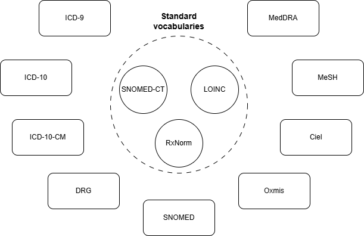

# Any-to-Any Terminology Mapping

[](https://pypi.org/project/aatm/)

[](https://github.com/astral-sh/uv)
[](https://github.com/astral-sh/ruff)
[](https://mypy-lang.org/)
[](https://opensource.org/licenses/MIT)

**Turn clinical text into coded, standard data.** AATM is an open-source Python library
that reads clinical documents with LLMs, codes what it finds with the
[OMOP standard vocabularies](https://athena.ohdsi.org/search-terms/start) (SNOMED CT,
LOINC, RxNorm, UCUM and the terminologies mapped to them), and writes
[OMOP CDM](https://ohdsi.github.io/CommonDataModel/cdm55.html) tables you can load and
analyse, with every value traceable to the words it came from.

| | What it does | Highlights |
|---|---|---|
| **[Clinical information extraction](#clinical-information-extraction)** | Finds conditions, drugs, devices, lab results, scores and dates in free-text notes, with their details | Grounded in the note, never paraphrased; nested entities and attributes; YAML definitions; any LLM |
| **[Medical coding](#medical-coding)** | Codes any clinical expression, in any language, to a standard concept | Semantic search over ~2.5M names and synonyms; LLM, decision-model or agent selection; every code checked |
| **[Notes to OMOP CDM tables](#notes-to-omop-cdm-tables)** | Both, end to end, into `condition_occurrence`, `drug_exposure`, `device_exposure`, `measurement` and `observation` | CDM conventions; provenance and issues; resumable, batched, sharded runs; a command line |

**Documentation: https://precisiondata.github.io/aatm**

---

## Install and set up

```bash
pip install aatm
aatm doctor   # tells you whether local models will use your GPU, and how to fix it
```

With [uv](https://docs.astral.sh/uv/), `uv pip install aatm --torch-backend=auto` also picks
the right PyTorch for your GPU. Extras: `aatm[anthropic]` for Anthropic models,
`aatm[pinecone]` for a Pinecone index, `aatm[pgvector]` for PostgreSQL with pgvector.

AATM cannot ship the OMOP vocabularies, since several have their own licences. Request
them on [Athena](https://athena.ohdsi.org/vocabulary/list) (SNOMED, LOINC, UCUM and
RxNorm cover every predefined definition), then pass the link Athena emails you:

```bash
aatm init --vocab-zip "https://athena.ohdsi.org/api/v1/vocabularies/zip/<bundle-id>"
```

This builds the vocabulary database and a search index of every concept name and
synonym, in `.aatm/`. Put your LLM provider's key in a `.env` file, e.g.
`OPENAI_API_KEY=...`. See
[Set up the vocabularies](https://precisiondata.github.io/aatm/latest/getting-started/setup/).

---

## Clinical information extraction

One structured LLM call per note, guided by **entity definitions**: a YAML file that
says, in words the model reads, what each entity is, what it contains and how to
classify it.

```python
from aatm.data_models.extractors import EntityDefinitions
from aatm.extractors import SimpleLLMExtractor

extractor = SimpleLLMExtractor(
    model_id="openai/gpt-5-mini",  # or gemini/..., anthropic/..., ollama/..., any OpenAI-compatible server
    entity_definitions=EntityDefinitions.from_predefined("drug_exposure"),
)
results = await extractor(["Home meds: metformin 500 mg PO BID since 2020. Allergic to penicillin."])

for drug in results[0].to_records():
    print(drug.text, drug.attributes, {k: [c.text for c in v] for k, v in drug.children.items()})
# e.g. metformin 500 mg {'kind': 'taking', 'route': 'oral'} {'verbatim_start_date': ['2020'], 'sig': ['500 mg PO BID']}
```

- **Grounded.** Each mention is kept only if its exact text is on the line the model
  gives, with character offsets into the note; rejected candidates are kept with the
  reason.
- **Structured.** Entities nest (a drug's dose, route and dates; a lab test's value and
  unit) and carry **attributes** from fixed labels (a condition's status, a drug's kind).
- **Eight predefined definitions** (conditions, drugs, devices, lab results, ECOG,
  smoking, family and medical history), or your own YAML, with editor completion.
- **Any LLM**: OpenAI, Gemini, Anthropic, OpenRouter, Ollama, vLLM or your own client,
  with shared rate limits and retries; decision models can label attributes with
  probabilities.

[Information extraction quick start](https://precisiondata.github.io/aatm/latest/getting-started/quick_start_extraction/)

## Medical coding

Code a term (a local code's description, a diagnosis from a note, a lab name in any
language) to a standard OMOP concept, and through it to every terminology the
vocabularies connect: an optional **translation**, a **retrieval** of candidates from the
search index, and a **selection** by the closest match, an LLM, a decision model, or an
**agent** that searches the vocabularies with tools (semantic and lexical search, code
lookups, the hierarchy) and reads the note's context.

```python
from aatm.concept_search import AgenticSelector
from aatm.terminology_mapper import TerminologyMapper

mapper = TerminologyMapper(selector=AgenticSelector("openai/gpt-5-mini"))
mapper.map(["HbA1c", "creatinina sérica", "dor torácica"], save_to_disk=False)
```

```bash
aatm map --input-file source_to_concept_map.csv --output-dir output --selector-id gpt-5-mini
```

- On 30 lab tests with gold LOINC codes, the agent with context coded **29** correctly,
  an LLM selector over 30 candidates 14, and the closest match 1.
- Every concept is checked to be standard, valid and of the right domain; searches can
  be restricted to a domain and vocabularies.
- Code a `SOURCE_TO_CONCEPT_MAP` CSV, a list of terms, a REST API (`aatm serve`), or
  explore in `aatm search-ui`. Six embedding models, local or hosted, in ChromaDB,
  Chroma Cloud, Pinecone or PostgreSQL with pgvector.

[Medical coding quick start](https://precisiondata.github.io/aatm/latest/getting-started/quick_start_python_api/)

<p align="center">
  
</p>

## Notes to OMOP CDM tables

Extraction and coding together, with the CDM's rules on top. From a CSV, Parquet or SQL
source with a `note_id` and a `text` per note (and `person_id`, `note_date`... when you
have them):

```bash
aatm omop run notes.parquet output/ \
  --definitions condition_occurrence --definitions drug_exposure \
  --model openai/gpt-5-mini --coder agent --cache
aatm omop status output/
```

```python
from aatm.omop import AgenticCoder, OmopExtractionPipeline, OmopRun

pipeline = OmopExtractionPipeline(
    ["condition_occurrence", "drug_exposure"],
    model_id="openai/gpt-5-mini",
    coder=AgenticCoder("openai/gpt-5-mini"),  # searches the vocabularies for each text
    cache=True,                               # codes each distinct text once
)
await pipeline.run("notes.parquet", "output/")

run = OmopRun("output/")
run.table("condition_occurrence")   # CDM rows, as a DataFrame
run.provenance()                    # the note and text span behind each row
run.issues()                        # what could not be filled, and why
```

- **Traceable**: every row keeps its source span; every gap is an issue with a reason.
- **Built for real datasets**: Parquet output, resumable runs, every model call paid
  once, rebuilds without re-extracting after a mapping change.
- **Cost under control**: a dry run estimates cost and time from a pilot; provider
  batch APIs halve the price; shards spread a run across machines.

[Quick start](https://precisiondata.github.io/aatm/latest/getting-started/quick_start_omop/) ·
[High-level guide: a full dataset](https://precisiondata.github.io/aatm/latest/getting-started/high_level/)

---

## High level or low level

| Level | You write | Guide |
|---|---|---|
| Command line | Flags, or a YAML file of options | [Command line reference](https://precisiondata.github.io/aatm/latest/reference/cli/) |
| Pipelines | A few lines of Python: `OmopExtractionPipeline`, `Pilot`, `TerminologyMapper` | [High-level guide](https://precisiondata.github.io/aatm/latest/getting-started/high_level/) |
| Building blocks | Your own LLM client, coder, selector or vocabulary source, plugged into the pipelines | [Low-level guide](https://precisiondata.github.io/aatm/latest/getting-started/low_level/) |

## Examples

Runnable notebooks with their output saved are in [`examples/`](./examples/README.md).

## Contributing

See the [Contributing guide](./CONTRIBUTING.md). What changed in each version is in the
[release notes](https://precisiondata.github.io/aatm/latest/release_notes/).

## License

MIT
