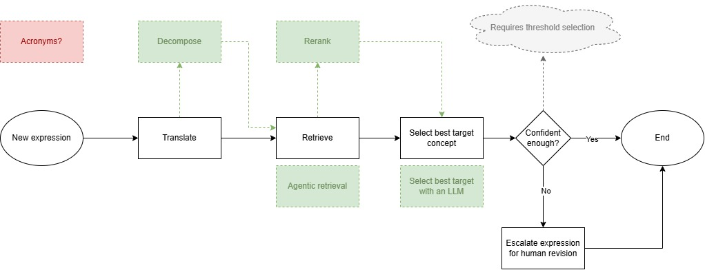

# Any-to-Any Terminology Mapping

[](https://pypi.org/project/aatm/)

[](https://github.com/astral-sh/uv)
[](https://github.com/astral-sh/ruff)
[](https://mypy-lang.org/)
[](https://opensource.org/licenses/MIT)

**AATM** is an open-source Python library that turns healthcare text into standard
concepts of the [OMOP vocabularies](https://athena.ohdsi.org/search-terms/start):

- **Clinical notes to OMOP tables.** An LLM extracts what your entity definitions
  describe; AATM checks every mention against the note, codes it with the vocabularies
  and fills the OMOP CDM `measurement`, `observation`, `condition_occurrence`,
  `drug_exposure` and `device_exposure` tables. Every row keeps the words it came from.
- **Information extraction.** Conditions, drugs, dates, scores and their attributes,
  grounded in the text, without tables.
- **Terminology mapping.** Local codes and descriptions, in any language, mapped to
  standard concepts as a `SOURCE_TO_CONCEPT_MAP`.

It runs from the command line or from Python, scales from one note to millions
(resumable runs, batch pricing, sharding, cost estimates), and every step can be
replaced by your own code.

**Documentation: https://precisiondata.github.io/aatm**

<p align="center">
  
</p>

---

## Install

```bash
uv pip install aatm --torch-backend=auto   # picks the right PyTorch for your GPU, or CPU
```

or with pip:

```bash
pip install aatm
aatm doctor   # tells you whether local models will use your GPU, and how to fix it
```

Extras: `aatm[anthropic]` for Anthropic models, `aatm[pinecone]` for a Pinecone index.

## Set up the vocabularies (once)

AATM cannot ship the OMOP vocabularies, since several have their own licences. Request
them on [Athena](https://athena.ohdsi.org/vocabulary/list) (SNOMED, LOINC, UCUM and
RxNorm cover every predefined definition), then pass the link Athena emails you:

```bash
aatm init --vocab-zip "https://athena.ohdsi.org/api/v1/vocabularies/zip/<bundle-id>"
```

This builds the vocabulary database and a search index of every concept name and
synonym in `.aatm/`. Put your LLM provider's key in a `.env` file, e.g.
`OPENAI_API_KEY=...`. See
[Set up the vocabularies](https://precisiondata.github.io/aatm/latest/getting-started/setup/).

## Clinical notes to OMOP tables

From a CSV or Parquet file with a `note_id` and a `text` per note (and `person_id`,
`note_date`... when you have them):

```bash
aatm omop run notes.parquet output/ \
  --definitions condition_occurrence --definitions drug_exposure \
  --model openai/gpt-5-mini --coder agent --cache
aatm omop status output/
```

The same in Python:

```python
from aatm.omop import AgenticCoder, OmopExtractionPipeline, OmopRun

pipeline = OmopExtractionPipeline(
    ["condition_occurrence", "drug_exposure"],
    model_id="openai/gpt-5-mini",
    coder=AgenticCoder("openai/gpt-5-mini"),  # searches the vocabularies for each text
    cache=True,                               # codes each distinct text once
)
summary = await pipeline.run("notes.parquet", "output/")

run = OmopRun("output/")
run.table("condition_occurrence")   # CDM rows, as a DataFrame
run.provenance()                    # the note and text span behind each row
run.issues()                        # what could not be filled, and why
```

Each table is written as Parquet files. Running the same command again resumes where it
stopped. Eight entity definitions are predefined (conditions, drugs, devices, lab
results, ECOG, smoking, family and medical history), and your own are YAML files.

- [Quick start: notes to OMOP tables](https://precisiondata.github.io/aatm/latest/getting-started/quick_start_omop/)
- [High-level guide: a full dataset](https://precisiondata.github.io/aatm/latest/getting-started/high_level/): pilot, cost estimate, run, rebuild, load
- [Writing entity definitions](https://precisiondata.github.io/aatm/latest/getting-started/entity_definitions/)

## Information extraction

```python
from aatm.data_models.extractors import EntityDefinitions
from aatm.extractors import SimpleLLMExtractor

extractor = SimpleLLMExtractor(
    model_id="openai/gpt-5-mini",  # or "gemini/...", "anthropic/...", "ollama/...", ...
    entity_definitions=EntityDefinitions.from_predefined("condition_occurrence"),
)
results = await extractor(["Type 2 diabetes since 2019. Denies chest pain."])

for record in results[0].to_records():
    print(record.text, record.attributes, {k: [c.text for c in v] for k, v in record.children.items()})
# e.g. Type 2 diabetes {'status': 'confirmed'} {'verbatim_start_date': ['2019']}
```

See the [Information extraction quick start](https://precisiondata.github.io/aatm/latest/getting-started/quick_start_extraction/).

## Terminology mapping

From a `SOURCE_TO_CONCEPT_MAP`-style CSV (`source_code`, `source_code_description`,
`source_vocabulary_id`...):

```bash
aatm map --input-file source_to_concept_map.csv --output-dir output --selector-id gpt-5-mini
```

```python
from aatm.terminology_mapper import TerminologyMapper

mapper = TerminologyMapper(selector="gpt-5-mini")   # an LLM picks among the candidates
mapped = mapper.map("source_to_concept_map.csv")
```

Each text is translated (optionally), searched in the index, reranked (optionally) and
matched to the best standard concept by the closest match, an LLM, a decision model or
an agent. See the
[terminology mapping quick start](https://precisiondata.github.io/aatm/latest/getting-started/quick_start_cli/).



## High level or low level

| Level | You write | Guide |
|---|---|---|
| Command line | Flags, or a YAML file of options | [High-level guide](https://precisiondata.github.io/aatm/latest/getting-started/high_level/) |
| Pipelines | A few lines of Python: `OmopExtractionPipeline`, `Pilot`, `TerminologyMapper` | [High-level guide](https://precisiondata.github.io/aatm/latest/getting-started/high_level/) |
| Building blocks | Your own LLM client, coder, selector or vocabulary source, plugged into the pipelines | [Low-level guide](https://precisiondata.github.io/aatm/latest/getting-started/low_level/) |

## Examples

Runnable notebooks with their output saved are in [`examples/`](./examples/README.md).

## Contributing

See the [Contributing guide](./CONTRIBUTING.md). What changed in each version is in the
[release notes](https://precisiondata.github.io/aatm/latest/release_notes/).

## License

MIT
