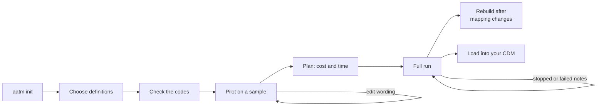

# High-level guide: a full dataset to OMOP tables

This guide is for the common case: you have thousands (or millions) of clinical notes
and want OMOP CDM tables from them, without writing more code than you must. It uses
the high-level surface of AATM only:

| Step | Command line | Python |
|---|---|---|
| Set up the vocabularies | `aatm init` | – |
| Iterate on a sample | `aatm omop pilot log / compare` | `Pilot` |
| Estimate cost and time | – | `pipeline.plan(...)` |
| Run, resume, retry | `aatm omop run` | `OmopExtractionPipeline.run` |
| Follow and inspect | `aatm omop status / failures` | `OmopRun` |
| Change the mappings | `aatm omop rebuild` | `pipeline.rebuild` |

When you need to replace or tweak one of the steps (your own LLM client, coder, or
table builder), see the [low-level guide](low_level.md).



---

## 1. Set up once

```bash
aatm init --vocab-zip "<the link Athena emailed you>" --embedding-model text-embedding-3-small
```

This builds the vocabulary database and the search index the coders use. See
[Set up the vocabularies](setup.md). Put your provider's key in `.env`.

## 2. Get the notes in shape

Every note needs a unique **`note_id`** (resuming, retries and row ids rely on it) and
its **`text`**. `person_id`, `note_date`, `visit_occurrence_id`, `visit_detail_id` and
`provider_id` fill the matching columns when present; a column the CDM requires that
stays empty is reported as an issue, never silently dropped.

A source can be a CSV or Parquet file, a folder of Parquet files, a DataFrame, a list
of `ClinicalNote` objects or dicts, or a SQL query on the CDM `note` table:

=== "Command line"

    ```bash
    aatm omop run output/full \
      --sql "SELECT note_id, note_text AS text, person_id, note_date, visit_occurrence_id FROM note" \
      --db sqlite:///cdm.db \
      --definitions condition_occurrence --model openai/gpt-5-mini --coder agent
    ```

=== "Python"

    ```python
    import sqlite3

    from aatm.omop import notes_from_sql

    source = notes_from_sql(
        "SELECT note_id, note_text AS text, person_id, note_date, visit_occurrence_id FROM note",
        sqlite3.connect("cdm.db"),  # or a SQLAlchemy engine for PostgreSQL, SQL Server...
    )
    ```

With a file, rename columns with `--columns note_text=text` (`columns={"note_text":
"text"}` in Python).

## 3. Choose what to extract

Start from the predefined definitions and add your own YAML files next to them:

| Definition | Table | Needs a coder |
|---|---|---|
| `ecog_performance_status` | `measurement` | no |
| `smoking_status` | `observation` | no |
| `lab_results` | `measurement` | yes |
| `family_history`, `medical_history` | `observation` | yes |
| `condition_occurrence` | `condition_occurrence` | yes |
| `drug_exposure` | `drug_exposure` | yes |
| `device_exposure` | `device_exposure` | yes |

A definition of your own describes what the model should find, in words, and where
each value goes in the table, in an `omop` block that the model never sees:

```yaml title="body_weight.yaml"
# yaml-language-server: $schema=https://precisiondata.github.io/aatm/latest/schemas/entity_definitions.schema.json
- name: Body weight
  key: body_weight
  definition: >
    The patient's measured body weight: the word for weight, the value and the unit,
    copied as written, e.g. "weight 72 kg". Stop at the unit.
  omop:
    table: measurement
    fields:
      person_id: {from: context.person_id}
      measurement_concept_id: {concept: "LOINC:29463-7"}
      measurement_date: {from: context.note_date}
      measurement_type_concept_id: {value: 32858}   # NLP
      measurement_source_value: {from: text}
      value_as_number: {from: child.weight_value, as: float}
      unit_concept_id: {from: child.weight_unit, lookup: UCUM}
      unit_source_value: {from: child.weight_unit}

- name: Weight value
  key: weight_value
  definition: The number of a body weight, without the unit, e.g. "72".
  has_parent: true
  parent_key: body_weight

- name: Weight unit
  key: weight_unit
  definition: The unit of a body weight, as written, e.g. "kg" or "lb".
  has_parent: true
  parent_key: body_weight
```

The first line gives your editor completion and inline errors for the file. See
[From notes to OMOP tables](omop_tables.md) for the `omop` block and
[Writing entity definitions](entity_definitions.md) for the rest.

## 4. Check the codes before any model call

```python
from aatm.data_models.extractors import EntityDefinitions
from aatm.omop import OmopTableBuilder

OmopTableBuilder(EntityDefinitions.from_yaml("body_weight.yaml")).describe_concepts()
```

Unknown columns, misspelt `child.` names, codes missing from your vocabularies,
non-standard concepts and concepts of the wrong domain fail here, with a message that
says what to fix. `aatm omop run` does the same checks before it reads a note.

## 5. Choose a coder

Definitions that code free text (`map:` in the YAML: lab names, diagnoses, drugs,
devices) need a coder:

| Coder | Flag | When |
|---|---|---|
| Terminology mapper | `--coder mapper --selector gpt-5-mini` | Explicit names; one search (and one LLM call) per distinct text; cheapest |
| Concept search agent | `--coder agent` | Abbreviations, other languages, variants that differ by specimen or unit; a few LLM calls per distinct text; most accurate |

On a 30-test lab benchmark the agent with the note's context got 29 right, the LLM
selector 14 ([details](coding_text.md#choosing-between-the-mapper-and-the-agent)).
Always turn on the coding cache (`--cache`, `cache=True`) for large runs: each distinct
text is then coded once, across chunks, reruns and rebuilds.

## 6. Iterate on a sample with a pilot

Wording is what you will change most, and every change means another run. A `Pilot`
picks a fixed sample once and keeps each attempt as a version, so you compare like with
like:

```python
from aatm.omop import AgenticCoder, OmopExtractionPipeline, Pilot

definitions = ["condition_occurrence", "drug_exposure", "./body_weight.yaml"]

def make_pipeline(**options):
    return OmopExtractionPipeline(
        definitions,
        model_id="openai/gpt-5-mini",
        coder=AgenticCoder("openai/gpt-5-mini"),
        **options,
    )

pilot = Pilot("pilot/", source="notes.parquet", sample=100, seed=0)
v1 = await pilot.run(make_pipeline(), prices={"openai/gpt-5-mini": (0.25, 2.00)})

v1.output().issues()     # what could not be filled, and why
v1.output().mappings()   # every coded text, with its score

# ... edit the wording in body_weight.yaml ...
v2 = await pilot.run(make_pipeline(), prices={"openai/gpt-5-mini": (0.25, 2.00)})
print(pilot.compare("v001", "v002"))
```

The comparison shows the rows per table, the issues per reason, every mention added,
removed or changed (with its line of the note), the codes that changed, and the cost per
note. When only an `omop` block changed, the new version is rebuilt from the stored
extractions, with no model call, and the versions share one coding cache
(`pilot/coding_cache.db`), so a text is coded once. From the shell:

```bash
aatm omop pilot log --path pilot --diff
aatm omop pilot compare --path pilot
```

Stop when the issues left are ones you accept. Common fixes are in the wording
("Stop at the unit") and in `min_score` for the coder, chosen from the real scores in
`mappings()`.

## 7. Estimate cost and time

`plan` is a dry run: no model call. With the pilot as a reference it predicts the full
run, and it warns about settings that would make it slow or expensive:

```python
pipeline = make_pipeline(cache=True)
print(pipeline.plan("notes.parquet", "output/full", pilot=v2.path))
```

```text
Run plan for output/full
notes: 120,000 in the source; 120,000 to extract
settings:
  max_concurrency  16   [default]  extraction calls in flight
  chunk_size       100  [default]  notes built and written together: it bounds memory, not extraction
estimate (from a pilot of 100 notes): 264,000 LLM calls, ... cost 182.21, about 9h40m (207 notes/min)
warnings: none
```

(The numbers are an illustration; yours come from your pilot.)

Then pick a setup:

| Your case | Setting |
|---|---|
| Hosted API, results can wait up to 24 h | `--batch` (about half the price) |
| Hosted API, needed today | `--max-concurrency 64` and the provider's rate limits |
| Local model (Ollama, vLLM), or several machines | `--shard <index>/<count>` |

[Tuning large OMOP runs](tuning_omop_runs.md) explains each setting.

## 8. Run it

Write the options in a file you commit, so the run can be repeated and reviewed:

```yaml title="run.yaml"
source: notes.parquet
output: output/full
definitions: [condition_occurrence, drug_exposure, ./body_weight.yaml]
model: openai/gpt-5-mini
coder: agent
cache: true
columns: {note_text: text, patient_id: person_id}
prices: {openai/gpt-5-mini: [0.25, 2.00]}
chunk_size: 200
```

```bash
aatm omop run --config run.yaml --limit 50   # a smoke test on 50 notes
aatm omop run --config run.yaml              # the full run
```

Flags override the file, e.g. `aatm omop run --config run.yaml --batch`. The Python
equivalent is `await pipeline.run("notes.parquet", "output/full", chunk_size=200)`.

The exit code tells a scheduler how it went: `0` every note built, `2` completed with
failed notes, `1` an error, `130` stopped with Ctrl+C.

## 9. Follow it, resume it, retry it

A progress line is logged every minute:

```text
Progress: 12,400 of 100,000 notes done (12.4%) in 41m10s, 301 notes/min; about 4h17m left;
12,380 built, 0 skipped, 20 failed; 31,950 LLM calls, 48,210,330 tokens; cost 14.2031;
cache hits 63%
```

```bash
aatm omop status output/full     # notes built and failed, rows per table, issues by reason
aatm omop failures output/full   # the failed notes, with their error
```

**Running the same command again resumes**: notes already built are skipped, notes
extracted but not yet written are built from their stored result, failed notes are
retried (3 attempts in all), and pending batch jobs are collected. Every model call is
stored as soon as it returns, so a crash loses none of them.

## 10. Change the mappings without extracting again

Extraction results are kept apart from the tables, in `output/full/ledger.db`. After
editing an `omop` block, or to switch coder, rebuild the tables from them:

```bash
aatm omop rebuild output/full --definitions ./body_weight.yaml
```

`rebuild` starts from the options the run recorded, so give only what changed. A change
to what is extracted (the definition text, the model) needs a new output folder: a run
refuses to mix them.

## 11. Use the output

```python
from aatm.omop import OmopRun

run = OmopRun("output/full")         # every shard, as one run
run.table("condition_occurrence")    # a DataFrame
run.provenance()                     # the note and text span behind each row
run.issues()
run.mappings()
run.dataset("drug_exposure")         # a pyarrow Dataset, to filter without loading it all
```

Each table is a folder of Parquet files in the CDM's columns, so loading it into your CDM
database is one statement in most engines, e.g. with DuckDB:

```sql
INSERT INTO cdm.condition_occurrence
SELECT * FROM 'output/full/condition_occurrence/*.parquet';
```

Row ids are `note_id * 65536 + n`, so the same note always gets the same ids, across
reruns, rebuilds and shards, and ids never repeat across tables. They need `BIGINT`
columns.

!!! warning "Review before you load"
    Every row is derived from text by a model. Read a sample of `run.provenance()`
    against the notes, review low scores in `run.mappings()`, and check the
    [current limits](omop_tables.md#current-limits) before you use the tables for
    analysis.

---

## Terminology mapping at the high level

If what you have is a list of local codes and descriptions rather than notes, the
high-level path is `aatm map` (or `TerminologyMapper`), which writes a
`SOURCE_TO_CONCEPT_MAP`-style CSV:

```bash
aatm map --input-file data/source_to_concept_map.csv --output-dir output --selector-id gpt-5-mini
```

See the [terminology mapping quick start](quick_start_cli.md).
