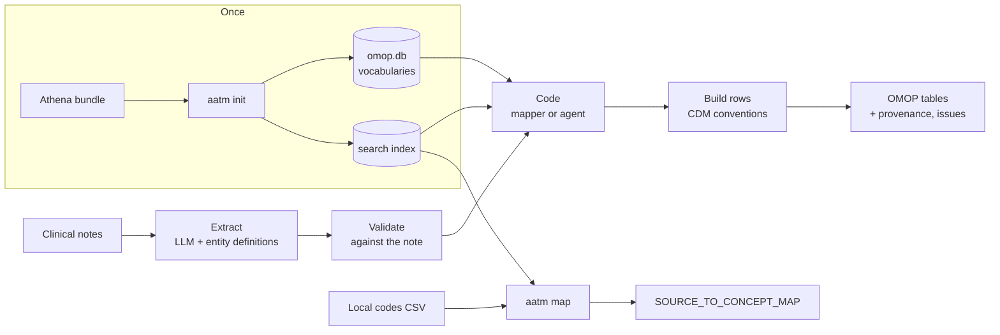

# Start here

This page tells you what to read, in which order, for what you want to do.

## 1. Set up (everyone, once)

1. [Install AATM](installation.md): `pip install aatm`, then `aatm doctor` to check
   whether local models will use your GPU.
2. [Set up the vocabularies](setup.md): request them on Athena and run `aatm init`. This
   builds the vocabulary database and the search index every workflow uses.
3. Put your LLM provider's key in a `.env` file ([Environment variables](env.md)).

## 2. Pick your path

=== "Notes to OMOP tables"

    1. [Quick start: notes to OMOP tables](quick_start_omop.md): a first table in
       minutes, then a file of notes.
    2. [High-level guide](high_level.md): a full dataset, from a pilot on a sample to
       loading the tables into your CDM.
    3. When the predefined definitions are not enough:
       [From notes to OMOP tables](omop_tables.md) (the `omop` block) and
       [Writing entity definitions](entity_definitions.md).
    4. When you need to tune: [Coding extracted text](coding_text.md),
       [Processing large datasets](large_datasets.md),
       [Tuning large OMOP runs](tuning_omop_runs.md).

=== "Information extraction only"

    1. [Information extraction quick start](quick_start_extraction.md): entities,
       validation and results, without tables.
    2. [Writing entity definitions](entity_definitions.md).
    3. [Low-level guide](low_level.md), to use your own LLM client or validate output
       produced elsewhere.

=== "Terminology mapping"

    1. [Terminology mapping from the command line](quick_start_cli.md): a CSV of local
       codes in, a mapped CSV out.
    2. [Terminology mapping in Python](quick_start_python_api.md): the same with
       `TerminologyMapper`, and each component on its own.
    3. [Basic concepts](concepts.md): retrievers, filters, rerankers, selectors.

## 3. Choose your level

The same work can be done at three levels. Start at the top and go down only for the
part you want to change: the levels mix, e.g. your own coder inside `aatm omop run`'s
Python equivalent.

| Level | You use | You control | Guide |
|---|---|---|---|
| Command line | `aatm init`, `aatm omop run / rebuild / status / failures / pilot`, `aatm map`, `aatm search-ui` | Options in flags or a YAML file | [High-level guide](high_level.md) |
| Pipelines | `OmopExtractionPipeline` (`__call__`, `run`, `plan`, `rebuild`), `Pilot`, `OmopRun`, `TerminologyMapper` | Plus: any Python object as a source, coder or model settings | [High-level guide](high_level.md) |
| Building blocks | `SimpleLLMExtractor`, `StructuredLLM`, `validate_extracted_entity`, `OmopTableBuilder`, `TextCoder`, retrievers, rerankers, selectors, `ConceptLookup` | Every step: write or replace any of them | [Low-level guide](low_level.md) |

## The whole pipeline at a glance

The [Basic concepts](concepts.md) page defines each box.
