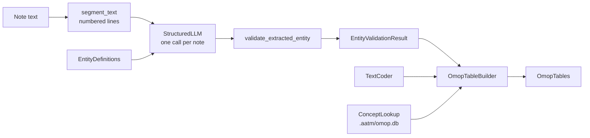

# Low-level guide: the building blocks

The [high-level guide](high_level.md) runs everything through `aatm omop run` or
`OmopExtractionPipeline`. Under them is a short chain of pieces, each usable on its own
and each replaceable. This guide shows them one by one, and how to put your own piece
back into the high-level pipeline, so you keep resuming, caching, batching and sharding.



| Piece | What it does | Replace it when |
|---|---|---|
| `EntityDefinitions` | What to extract, and where it goes (`omop` blocks) | You generate definitions in code |
| `StructuredLLM` (from `aatm.llm.create_llm`) | One structured-output call | You go through a gateway, or a provider AATM does not support |
| `SimpleLLMExtractor` | Numbers the lines, calls the model, validates its answer | You extract with another system, or need another prompt |
| `validate_extracted_entity` | Grounds every span in the note, checks keys, parents, labels | You validate output produced elsewhere |
| `DecisionAttributeLabeller` | Labels attributes with a decision model instead of the extractor | Attribute labels need calibrated probabilities |
| `TextCoder` (`TerminologyMapper`, `AgenticCoder`) | Codes extracted text to standard concepts | You have a local dictionary or your own search |
| `ConceptLookup` (`SqliteConceptLookup`) | Looks concepts up by code and id; follows *Maps to* | Your vocabularies live in a database server |
| `OmopTableBuilder` | Turns validated entities into CDM rows, with provenance and issues | You build rows from stored or external results |

---

## 1. Extraction on its own

```python
from aatm.data_models.extractors import EntityDefinitions
from aatm.extractors import SimpleLLMExtractor

definitions = EntityDefinitions.from_predefined("condition_occurrence")
extractor = SimpleLLMExtractor(
    model_id="openai/gpt-5-mini",
    entity_definitions=definitions,
    settings={"reasoning_effort": "low"},
    on_error="record",          # a failing note gets an empty result with .error
)

results = await extractor(["Type 2 diabetes since 2019. Denies chest pain."])
for record in results[0].to_records():
    print(record.key, record.text, record.attributes,
          {k: [c.text for c in v] for k, v in record.children.items()})
```

```text
condition_name Type 2 diabetes {'status': 'confirmed'} {'verbatim_start_date': ['2019']}
```

Each result keeps the rejected candidates too (`results[0].unmatched_entities`, with
reasons), which is the fastest way to debug a definition. Everything about extraction,
including the arguments of `SimpleLLMExtractor` and the validation rules, is in the
[Information extraction quick start](quick_start_extraction.md).

To see exactly what the model reads:

```python
print(definitions.to_prompt_str())   # the definitions, without the omop blocks
print(extractor.instructions)        # the full system prompt
```

## 2. Your own LLM client

Every model call in AATM goes through a `StructuredLLM`: an object with a `model_id`
and an async `generate` that returns an instance of a Pydantic model. Wrap your
client in one and pass it as `llm=`:

```python
from typing import TypeVar

from pydantic import BaseModel

from aatm.extractors import SimpleLLMExtractor
from aatm.llm import LLMResponseError, get_rate_limiter
from aatm.llm.limits import estimate_tokens
from aatm.llm.usage import record_usage

T = TypeVar("T", bound=BaseModel)


class GatewayLLM:
    """Calls a hospital LLM gateway that returns JSON matching a schema."""

    def __init__(self, client, model: str):
        self.client = client
        self.model_id = f"gateway/{model}"   # shown in usage and run summaries

    async def generate(self, *, system: str, user: str, output_type: type[T]) -> T:
        # Optional, but gives your client AATM's rate limits and retries.
        return await get_rate_limiter(self.model_id).run(
            lambda: self._generate(system, user, output_type),
            estimated_tokens=estimate_tokens(system, user),
        )

    async def _generate(self, system: str, user: str, output_type: type[T]) -> T:
        response = await self.client.complete(
            system=system, user=user, json_schema=output_type.model_json_schema()
        )
        # Optional: counts the call's tokens in track_usage and run summaries.
        record_usage(response.input_tokens, response.output_tokens, model_id=self.model_id)
        if not response.text:
            raise LLMResponseError("empty response")
        return output_type.model_validate_json(response.text)


extractor = SimpleLLMExtractor(
    llm=GatewayLLM(my_client, "clinical-70b"), entity_definitions=definitions
)
```

To make it available by model id to every piece in your process
(`OmopExtractionPipeline(model_id=...)`, `AgenticCoder(...)`, `set_rate_limits`),
register a provider:

```python
from aatm.llm import register_provider

register_provider(
    "gateway",
    lambda model, *, api_key, base_url, settings: GatewayLLM(my_client, model),
)
extractor = SimpleLLMExtractor(model_id="gateway/clinical-70b", entity_definitions=definitions)
```

Any OpenAI-compatible server (vLLM, LM Studio, Together...) needs no code:
`model_id="openai-compatible/<model>", base_url="http://localhost:8000/v1"`.

**Limits and usage.** `set_rate_limits` applies to every call of a model id that goes
through `get_rate_limiter`, as the built-in clients and the example above do, whichever
piece makes it. `track_usage` counts the calls and tokens of a block:

```python
from aatm.llm import set_rate_limits, track_usage

set_rate_limits("gateway", max_concurrency=8, requests_per_minute=600)
with track_usage() as usage:
    results = await extractor(notes)
print(usage)
```

## 3. Validating output from elsewhere

If entities come from another system, or from a model you call yourself, validate them
the same way. The model must answer with line ids from `segment_text`:

```python
from aatm.data_models.extractors import (
    ExtractedEntityCandidates,
    segment_text,
    validate_extracted_entity,
)

note = "Hypertension, diagnosed 2015."
print(segment_text(note))   # the numbered lines the model must refer to

candidates = ExtractedEntityCandidates.model_validate({"entities": [
    {"id": "e1", "text": "Hypertension", "key": "condition_name", "line": "L1",
     "parents": [], "attributes": [{"key": "status", "value": "confirmed"}]},
    {"id": "e2", "text": "2015", "key": "verbatim_start_date", "line": "L1",
     "parents": ["e1"]},
]})
result = validate_extracted_entity(note, definitions, candidates)
```

`result` is the same `EntityValidationResult` the extractor returns, so it can go
straight to the table builder.

## 4. Building the tables yourself

`OmopTableBuilder` is the second half of the pipeline. Give it notes and their
extraction results, in the same order:

```python
from aatm.omop import ClinicalNote, OmopTableBuilder

builder = OmopTableBuilder(
    definitions,                 # with omop blocks
    vocabulary=".aatm/omop.db",  # or a ConceptLookup of your own
    coder=my_coder,              # needed when a definition uses `map`
    dayfirst=True,               # "05/12/2025" is 5 December
)
builder.describe_concepts()      # every fixed code, resolved: check before building

notes = [ClinicalNote(text=note, note_id=1, person_id=7, note_date="2025-06-01")]
tables = builder.build(notes, [result], row_ids="note")

tables["condition_occurrence"]
tables.issues_dataframe()
tables.mappings_dataframe()
```

`row_ids="note"` numbers rows from the note id (`note_id * 65536 + n`), as full runs
do, so rows built in separate calls never clash. All checks of the `omop` blocks run
when the builder is created, before any note.

This is also how to rebuild tables from extraction results you stored yourself, e.g.
as JSON: `EntityValidationResult.model_validate_json(...)`.

## 5. Your own coder

A coder turns texts into concept ids. Any object with a `code` method that returns
one `CodedText` per text is one:

```python
from aatm.omop import CodedText


class DictionaryCoder:
    """Codes texts from a reviewed local dictionary."""

    def __init__(self, concept_ids: dict[str, int]):
        self.concept_ids = concept_ids

    def code(self, texts, domain=None, vocabularies=None):
        return [
            CodedText(text=t, concept_id=self.concept_ids.get(t.lower()), score=1.0)
            for t in texts
        ]

    def cache_identity(self):    # optional: lets cache=True store its results
        return {"coder": "DictionaryCoder", "concept_ids": self.concept_ids}
```

The builder calls it once per domain and set of vocabularies, with each distinct text
once, and checks every concept it returns against the vocabulary: a non-standard one is
stored as `0` and reported. Coders can also read each text's context (the unit next to
a lab name, the line of the note): see
[Writing your own coder](coding_text.md#writing-your-own-coder).

A configured `TerminologyMapper` is a coder too, so every retriever, reranker and
selector below can code OMOP rows.

## 6. Labelling attributes with a decision model

By default the extraction call chooses attribute labels (a condition's `status`, a
drug's `kind`). A decision model answers closed-set questions with probabilities
instead, and can check the extractor's labels:

```python
from aatm.extractors import DecisionAttributeLabeller, SimpleLLMExtractor

extractor = SimpleLLMExtractor(
    model_id="openai/gpt-5-mini",
    entity_definitions=definitions,
    attribute_labeller=DecisionAttributeLabeller(
        "openrouter/typesafe/jev-1.13", mode="verify", min_probability=0.8
    ),
)
```

Labels it cannot confirm are listed in `tables.attribute_reviews_dataframe()`. See
[Decision models](../reference/decision_models.md).

## 7. Putting your pieces back into a full run

`OmopExtractionPipeline` takes your extractor and your coder, and its `run`, `plan` and
`rebuild` then work as in the [high-level guide](high_level.md):

```python
from aatm.omop import OmopExtractionPipeline

pipeline = OmopExtractionPipeline(
    definitions,
    extractor=extractor,     # e.g. with your own llm= or attribute_labeller=
    coder=DictionaryCoder({"hb": 3000963}),
    cache=True,
)
summary = await pipeline.run("notes.parquet", "output/custom", chunk_size=200)
```

What a run needs from an extractor:

- an async call, `await extractor(texts)`, returning one `EntityValidationResult` per
  text, in order (set `error` on a result rather than raising, to record that note as
  failed and go on);
- optionally `model_id`, `instructions` and `max_concurrency` attributes: the run uses
  them to recognise a folder made with another extractor, and to choose its
  concurrency;
- `submit_batch` and `poll_batch`, only for `batch=True`.

Settings of the default extractor (`settings=`, `max_concurrency=`, `instructions=`...)
must then be set on your extractor: the pipeline raises rather than ignore them.

---

## Terminology mapping, piece by piece

`TerminologyMapper` chains four components. Each is callable on its own, and they
compose with `|`:

```python
from aatm.registries.rerankers import load_reranker
from aatm.registries.retrievers import load_retriever
from aatm.registries.selectors import load_selector
from aatm.registries.translators import load_translator

translator = load_translator("empty-translator")   # or "gemini-2.5-flash" to translate first
retriever = load_retriever()                         # the index aatm init built
retriever.top_k = 30
reranker = load_reranker("bm25-reranker")
selector = load_selector("gpt-5-mini")               # an LLM picks among the candidates

candidates = ["dor torácica", "HbA1c"] | translator | retriever
selected = candidates | reranker | selector
```

`candidates.results[i]` lists the retrieved concepts for query `i`, each with its
`std_concept_id`, `std_concept_name`, `std_vocabulary_id`, `std_domain_id` and
`distance`, which is what you need to write your own selector:

```python
from aatm.data_models import (
    EmptySelectionMetadata,
    RetrieverResults,
    SelectedExpressionMetadata,
    SelectorResults,
)
from aatm.data_models.data_models import StandardVocabulary
from aatm.selectors import BaseSelector


class PreferVocabularySelector(BaseSelector):
    """The closest candidate of a preferred vocabulary, else the closest one."""

    def __init__(self, vocabulary: StandardVocabulary = StandardVocabulary.LOINC):
        self.vocabulary = vocabulary

    def select(self, results: RetrieverResults) -> SelectorResults:
        chosen = []
        for candidates in results.results:
            if not candidates:
                chosen.append(EmptySelectionMetadata())
                continue
            preferred = [c for c in candidates if c.std_vocabulary_id == self.vocabulary]
            pick = (preferred or candidates)[0]
            chosen.append(
                SelectedExpressionMetadata(
                    **pick.model_dump(), result_list_index=candidates.index(pick)
                )
            )
        return SelectorResults(results=chosen, queries=results.queries)
```

Then use it like any other: `TerminologyMapper(selector=PreferVocabularySelector())`,
or as a coder in an OMOP run (`coder=TerminologyMapper(...)`).

**Filters.** A retriever can restrict candidates to a domain and vocabularies; the OMOP
builder does this for every `map` source:

```python
from aatm.omop.coding import retriever_filter

retriever(["hemoglobin"], where=retriever_filter("Measurement", ["LOINC"]))
```

How filtering works, and its speed on large indexes, is in
[Basic concepts](concepts.md#metadata-filters). Every component class is documented in
the API reference.

## The vocabulary database

The builder, the agent and the checks all read `.aatm/omop.db` through a
`ConceptLookup`. You can query it too:

```python
from aatm.omop import ConceptRef, SqliteConceptLookup

vocab = SqliteConceptLookup(".aatm/omop.db")
ref = ConceptRef.parse("SNOMED:423740007")
concept = vocab.by_code([ref])[ref]
print(concept, concept.is_standard)
print(vocab.maps_to([concept.concept_id]))   # the standard concepts it maps to
```

To keep the vocabularies in a database server instead, implement the same four methods
(`by_code`, `by_id`, `maps_to`, `search_codes`; see `aatm.omop.vocabulary.ConceptLookup`)
and pass the object as `vocabulary=`.
