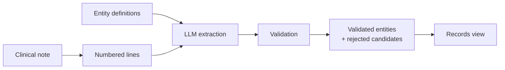

# Information Extraction Quick Start

This page shows how to extract structured information, such as conditions, drugs and
their dates, from clinical documents with the **AATM information extraction pipeline**.

---

## What the pipeline does

Given a clinical note and a set of **entity definitions** (what to extract), the
pipeline asks an LLM to find every relevant mention and then **validates** the answer
against the note. Only spans that really exist in the note survive, each with its exact
character position, linked to the entity it belongs to.



The main pieces are:

| Piece | Where | Role |
|---|---|---|
| `EntityDefinitions` | `aatm.data_models.extractors` | Which entities to extract, loaded from YAML |
| `SimpleLLMExtractor` | `aatm.extractors` | Sends each note to the LLM and validates the output |
| `validate_extracted_entity` | `aatm.data_models.extractors` | Grounds and checks the model output (also usable on its own) |
| `EntityValidationResult` | `aatm.data_models.extractors` | Validated entities, rejected candidates and the records view |

The extracted text (for example `"Hypertension"` or `"Furosemide 40 mg"`) can then be
mapped to standard concepts with the terminology mapping pipeline.

---

## 1. Requirements

- A model that supports structured outputs, from one of the providers below. Model ids
  are prefixed with the provider: `<provider>/<model name>`.
- The provider's API key in its environment variable (see [Environment variables](env.md)),
  or passed with `api_key=...`.

| Provider | `model_id` example | Key | Notes |
|---|---|---|---|
| OpenAI | `openai/gpt-5` | `OPENAI_API_KEY` | |
| Google Gemini | `gemini/gemini-3-flash-preview` | `GOOGLE_API_KEY` | |
| Anthropic | `anthropic/claude-opus-5-5` | `ANTHROPIC_API_KEY` | Install with `pip install "aatm[anthropic]"` |
| Ollama | `ollama/llama3.3` | none | Uses `http://localhost:11434/v1` unless `base_url` is given |
| OpenRouter | `openrouter/qwen/qwen3-235b-a22b` | `OPENROUTER_API_KEY` | |
| Any OpenAI-compatible server (vLLM, LM Studio, Together, ...) | `openai-compatible/<model>` | `api_key=...` if needed | Requires `base_url=...` |

```python
extractor = SimpleLLMExtractor(
    model_id="openai-compatible/Qwen/Qwen3-32B",
    base_url="http://localhost:8000/v1",  # e.g. a local vLLM server
    entity_definitions=entity_definitions,
)
```

Other providers can be added with `aatm.llm.register_provider`, or by passing any object
with an async `generate(system=..., user=..., output_type=...)` method as `llm=...`.

---

## 2. A first extraction

```python
from aatm.data_models.extractors import EntityDefinitions
from aatm.extractors import SimpleLLMExtractor

entity_definitions = EntityDefinitions.from_predefined("condition_occurrence")

extractor = SimpleLLMExtractor(
    model_id="openai/gpt-5",  # or "gemini/...", "anthropic/...", "ollama/...", ...
    entity_definitions=entity_definitions,
)

note = """## Problem list
* Hypertension, diagnosed 2015
* Type 2 diabetes mellitus and CKD stage 3, both diagnosed 2019

## Assessment
Hypertension worsened since March 2026."""

results = await extractor([note])  # one result per note, in the same order
result = results[0]

for entity in result.validated_entities:
    print(entity.id, entity.key, repr(entity.text), entity.line, entity.start, entity.end, entity.parents)
```

The extractor is **asynchronous**. In a notebook you can `await` it directly; in a
script, wrap the call:

```python
import asyncio

results = asyncio.run(extractor([note]))
```

Several notes can be passed at once. Use `max_concurrency` to control how many model
calls run in parallel (default: 1):

```python
extractor = SimpleLLMExtractor(
    model_id="openai/gpt-5",
    entity_definitions=entity_definitions,
    max_concurrency=4,
)
results = await extractor(list_of_notes)
```

---

## 3. Entity definitions

Entity definitions tell the model **what** to extract. Each definition has a name, a
key, a definition text (this is what the model reads, so write it carefully) and,
optionally, a parent and attributes. This section is a summary; see
[Writing entity definitions](entity_definitions.md) for every field, how to choose
between them, YAML pitfalls and how to check a file before using it.

### Predefined definitions

AATM ships definitions aligned with OMOP CDM tables and common clinical scales:

| Name | Keys |
|---|---|
| `condition_occurrence` | `condition_name`; children of a condition: `verbatim_start_date`, `verbatim_end_date` |
| `drug_exposure` | `drug_name`; children of a drug: `verbatim_start_date`, `verbatim_end_date`, `route_source_value`, `dose_unit_source_value`, `sig` |
| `ecog_performance_status` | `ecog_performance_status` with attributes `score` (`0`-`5`), or `score_range_min` / `score_range_max` for a range such as "ECOG 0-1"; child of a status: `assessment_date` |
| `lab_results` | `lab_test` with attribute `operator` (`<`, `<=`, `>`, `>=`); children of a test: `lab_value`, `lab_unit`, `lab_date` |
| `smoking_status` | `smoking_status` with required attribute `status` (`never`, `former`, `current_every_day`, `current_some_day`, `current_unknown_frequency`, `not_current`); `pack_years` with child `pack_years_value` |
| `family_history` | `family_history` (the condition) with attribute `relative` (`mother`, `father`, `sister`, ...) |

```python
EntityDefinitions.from_predefined("drug_exposure")
```

### Writing your own

Definitions are a YAML list:

```yaml title="my_definitions.yaml"
- name: Allergen
  definition: A substance the patient is allergic to, e.g. "penicillin" or "peanuts".

- name: Reaction
  definition: The reaction caused by an allergen, e.g. "rash" or "anaphylaxis".
  has_parent: true
  parent_key: allergen
```

```python
entity_definitions = EntityDefinitions.from_yaml("my_definitions.yaml")
```

Or build them in Python:

```python
from aatm.data_models.extractors import EntityDefinition, EntityDefinitions

entity_definitions = EntityDefinitions(
    entities=[
        EntityDefinition(name="Allergen", definition="A substance the patient is allergic to."),
        EntityDefinition(
            name="Reaction",
            definition="The reaction caused by an allergen.",
            has_parent=True,
            parent_key="allergen",
        ),
    ]
)
```

Rules:

- **`key`** is optional. If omitted, it is generated from the name: lowercase, accents
  removed, other characters replaced by `_` (`"Condição — Início"` becomes
  `condicao_inicio`). A key you write yourself must already be in that form.
- **Parents**: an entity with `has_parent: true` must set `parent_key` to the key of
  another definition, and every extracted mention of it must be linked to a mention of
  that parent. Hierarchies can have any depth (drug → dose → unit).
- **Invalid files fail when loaded**, before any model call, with a message that names
  the file: keys that are not lowercase `snake_case`, duplicate keys, a `parent_key` that does not exist, an entity that is its
  own parent, `has_parent` without `parent_key` (or the reverse), and loops such as
  `a -> b -> a`. For example:

```text
ValueError: Invalid entity definitions in my_definitions.yaml:
1 validation error for EntityDefinitions
  Value error, Cycle in entity parent keys: drug_name -> unit -> dose -> drug_name
```

### Attributes: classifying each mention

Sometimes you need more than the span: you also want to know what the note says
*about* it. Attributes let the model assign one label from a fixed list to each mention.
The label does not have to appear in the text.

```yaml title="brca.yaml"
- name: BRCA gene test
  key: brca_test
  definition: A mention of BRCA1 and/or BRCA2 genetic testing performed for the patient.
  attributes:
    - key: result
      description: The result of the test as stated in the note.
      labels:
        - value: positive
          description: A pathogenic or likely pathogenic variant was reported.
        - value: negative
          description: No pathogenic or likely pathogenic variant was found.
        - value: uncertain
          description: Only a variant of uncertain significance (VUS) was reported.
```

- **Write a description for every label.** The model reads them to decide, so they are
  where you settle edge cases (is a VUS "uncertain" or "negative"?).
- **Attributes are optional by default.** When the note does not say, the model leaves
  the attribute out and the mention is kept without it. It is told never to guess, so
  "not stated" and a real `uncertain` result stay distinct.
- **`required: true`** means a mention is only useful with this attribute: a mention
  without a valid label for it is rejected, with its children (see
  [Attribute issues](#attribute-issues)).

See [Attributes](entity_definitions.md#attributes-what-the-note-says-about-a-mention)
for when to use an attribute instead of a child entity, and how to write labels.

---

## 4. What the model sees and returns

The note is split into **numbered lines** before it is sent to the model. Blank lines
are skipped and every line keeps its position in the original note:

```text
[L1] ## Problem list
[L2] * Hypertension, diagnosed 2015
[L3] * Type 2 diabetes mellitus and CKD stage 3, both diagnosed 2019
[L4] ## Assessment
[L5] Hypertension worsened since March 2026.
```

For every mention, the model returns:

| Field | Meaning |
|---|---|
| `id` | A local id, unique in the response: `e1`, `e2`, ... |
| `text` | The exact text, copied from the line |
| `key` | The entity key from the definitions |
| `line` | The line the mention is on, e.g. `L2` |
| `occurrence` | Only when the same text appears more than once on that line: which one (1-based) |
| `parents` | The ids of the parent mentions, e.g. `["e1"]`; several parents are allowed |
| `attributes` | Labels for the entity's attributes, e.g. `[{"key": "result", "value": "negative"}]`; attributes the note does not state are left out |

Because each mention has a line and each link points to an id, the result is
unambiguous: the `2015` above belongs to the `Hypertension` on line 2, not the one on
line 5.

Lines are kept whole by default. For notes with very long paragraphs (or text that lost
its line breaks), you can split long lines at sentence boundaries:

```python
extractor = SimpleLLMExtractor(..., max_segment_chars=400)
```

The sentence splitter is simple and also splits after abbreviations such as `p.o.`, so
only enable it when your notes need it.

---

## 5. Validation

The model output is never trusted as is. Each candidate is checked, and the ones that
fail are kept in `result.unmatched_entities` with the reasons:

| Reason | Meaning |
|---|---|
| `invalid_line` | The line id does not exist |
| `invalid_text` | The text does not appear anywhere in the note |
| `text_not_in_line` | The text is in the note, but not on the given line |
| `invalid_occurrence` | The line has fewer copies of the text than `occurrence` |
| `invalid_key` | The key is not in the entity definitions |
| `required_parent_missing` | The entity needs a parent but lists none |
| `invalid_parent` | A parent id does not exist or has the wrong key |
| `parent_rejected` | A parent was itself rejected |
| `unexpected_parent` | An entity without a parent definition lists parents |
| `duplicate_id` | An id was reused; the first entity keeps it |
| `duplicate` | The same mention (same span and key) was extracted twice |
| `required_attribute_missing` | A required attribute was not given |
| `invalid_required_attribute` | A required attribute was given with a label that is not defined |

Matching is exact: case, spacing and punctuation must be identical to the note. Small
formatting slips are tolerated: `line` may be written `L4`, `[L4]` or `4`, and a copied
`[L4]` prefix is removed from `text`.

When the same mention is extracted twice, the first one is kept, the parents of both
are combined, and any child pointing at the dropped copy is relinked to the kept one.

For the note above, a response with three deliberate mistakes gives:

```text
Validated:
  e1  condition_name       'Hypertension'              L2  [18:30]   parents=[]
  e2  verbatim_start_date  '2015'                      L2  [42:46]   parents=['e1']
  e3  condition_name       'Type 2 diabetes mellitus'  L3  [49:73]   parents=[]
  e4  condition_name       'CKD stage 3'               L3  [78:89]   parents=[]
  e5  verbatim_start_date  '2019'                      L3  [106:110] parents=['e3', 'e4']
  e6  condition_name       'Hypertension'              L5  [126:138] parents=[]
Rejected:
  e7  'March 2026'    L4  ['text_not_in_line']   # the text is on L5
  e8  '2026'          L5  ['invalid_parent']     # its parent id does not exist
  e9  'Hypertension'  L2  ['duplicate']          # same mention as e1
```

`result.unmatched_keys` lists the definition keys with no validated entity (here
`['verbatim_end_date']`), which helps spot what the model never found.

### Attribute issues

A wrong label never throws away a valid span unless the attribute is required. Every
problem is recorded as an `AttributeIssue` with the candidate id, the entity key, the
attribute key, the value the model gave and a reason, so you can see which attribute
causes trouble:

| Reason | Meaning | What is kept |
|---|---|---|
| `unknown_attribute` | The entity has no attribute with this key | The span, without it |
| `invalid_label` | The value is not one of the defined labels | The span, without it (rejected if the attribute is required) |
| `missing_required` | A required attribute was not given | Nothing: the span is rejected |
| `conflicting_values` | The same attribute was given twice with different values | The first valid value |
| `conflicting_duplicate` | A duplicate mention gave a different value | The first mention's value (`kept_entity_id`, `kept_value`) |

Issues are split by the attribute's definition:

- `result.required_attribute_issues`: issues on required attributes. A
  `missing_required` or `invalid_label` here means the mention was rejected (and its
  children, with `parent_rejected`).
- `result.optional_attribute_issues`: issues on optional or unknown attributes. The
  mention was kept.

Three more rules decide what is reported:

- **Case and surrounding spaces are ignored.** A model answer of `" Negative "` is
  accepted as `negative`, stored exactly as defined, and not reported. Only values
  that match no label become `invalid_label`.
- **Attributes are checked only for candidates that pass every other check.** A
  candidate rejected for its text, line, key or parent adds no attribute issues, so
  the issue counts cover only mentions that were really found.
- **Duplicates keep the first mention's labels.** A label the kept mention lacks is
  copied from the duplicate, a different label is reported as
  `conflicting_duplicate`, and a duplicate that is missing a required attribute is
  not reported, since the kept mention already has it.

To find the attributes that cause the most problems across many notes:

```python
from collections import Counter

counts = Counter(
    (issue.entity_key, issue.attribute_key, issue.reason)
    for result in results
    for issue in result.required_attribute_issues + result.optional_attribute_issues
)
```

---

## 6. Working with the results

`extractor(...)` returns one `EntityValidationResult` per note:

| Attribute / method | Content |
|---|---|
| `validated_entities` | Validated entities in document order, each with `id`, `key`, `text`, `line`, `start`, `end`, `parents` (ids) and valid `attributes`; `entity.get_attribute("result")` returns one label |
| `unmatched_entities` | Rejected candidates with their `reasons` |
| `unmatched_keys` | Definition keys with no validated entity |
| `required_attribute_issues` | Problems with required attributes |
| `optional_attribute_issues` | Problems with optional or unknown attributes |
| `get_entity(id)` | One validated entity by id |
| `to_records()` | Entities nested under their parents |

### Follow links between entities

```python
date = result.get_entity("e5")
[result.get_entity(p).text for p in date.parents]
# ['Type 2 diabetes mellitus', 'CKD stage 3']
```

`start` and `end` are character offsets in the original note, so
`note[entity.start:entity.end] == entity.text` always holds.

### Records view

`to_records()` returns one record per entity without parents, with its children grouped
by key. A child with several parents appears under each of them:

```python
for record in result.to_records():
    print(record.text, record.line, {k: [c.text for c in v] for k, v in record.children.items()})
```

```text
Hypertension L2 {'verbatim_start_date': ['2015']}
Type 2 diabetes mellitus L3 {'verbatim_start_date': ['2019']}
CKD stage 3 L3 {'verbatim_start_date': ['2019']}
Hypertension L5 {}
```

Each record also has `attributes`, a plain `{key: label}` dict, e.g.
`{"result": "negative"}`.

### Building table rows

Records map naturally to OMOP-like rows:

```python
rows = []
for record in result.to_records():
    starts = record.children.get("verbatim_start_date", [])
    ends = record.children.get("verbatim_end_date", [])
    rows.append(
        {
            "condition_source_value": record.text,
            "verbatim_start_date": starts[0].text if starts else None,
            "verbatim_end_date": ends[0].text if ends else None,
            "evidence": f"{record.line} [{record.start}:{record.end}]",
        }
    )
```

Dates are returned exactly as written in the note (`"2015"`, `"March 2026"`) and still
need to be normalized, and `condition_source_value` still needs to be mapped to a
standard concept.

---

## 7. Validating without calling a model

`validate_extracted_entity` works on any model output that follows the
`ExtractedEntityCandidates` schema. This is useful in tests, or to validate the output of
a model called outside AATM:

```python
from aatm.data_models.extractors import (
    ExtractedEntityCandidates,
    validate_extracted_entity,
)

candidates = ExtractedEntityCandidates.model_validate(
    {
        "entities": [
            {"id": "e1", "text": "Hypertension", "key": "condition_name", "line": "L2", "occurrence": None, "parents": []},
            {"id": "e2", "text": "2015", "key": "verbatim_start_date", "line": "L2", "occurrence": None, "parents": ["e1"]},
        ]
    }
)
result = validate_extracted_entity(note, entity_definitions, candidates)
```

The line ids are computed with `segment_text(note)`. If you used `max_segment_chars`,
pass the same segments: `validate_extracted_entity(note, defs, candidates,
segments=segment_text(note, max_segment_chars=400))`.

---

## 8. Customizing the extractor

| Argument | Default | Purpose |
|---|---|---|
| `model_id` | required unless `llm` is given | `<provider>/<model>`, see [Requirements](#1-requirements) |
| `entity_definitions` | required | What to extract |
| `api_key` | `None` | Provider key; the provider's environment variable is used when omitted |
| `base_url` | `None` | Server URL for OpenAI-compatible providers |
| `settings` | `None` | `aatm.llm.LLMSettings` or a dict, e.g. `{"temperature": 0, "max_tokens": 8000}` |
| `llm` | `None` | A ready-made `aatm.llm.StructuredLLM`, used instead of `model_id` |
| `max_concurrency` | `1` | Parallel model calls |
| `max_segment_chars` | `None` | Split lines longer than this at sentence boundaries |
| `instructions` | built-in prompt | Custom system prompt; `{output_format}` and `{entity_definitions}` are filled in |

`settings` accepts `temperature`, `max_tokens`, `reasoning_effort` (`"minimal"` to
`"max"`), `timeout` (seconds) and `provider_kwargs` (extra arguments passed as-is to the
provider's API call). Settings left unset use the provider's defaults. Current Anthropic
models do not accept `temperature`, so it is ignored there with a warning.

When writing custom instructions, keep the explanation of line ids, ids, parents and
attributes from the built-in prompt
(`aatm.extractors.llm_extractors.DEFAULT_INSTRUCTION`); validation expects them.

---

## 9. Debugging

AATM is silent by default. To see what validation does:

```python
import logging
import aatm

aatm.configure_logging()  # shows AATM messages on stderr
logging.getLogger("aatm.data_models.extractors").setLevel(logging.DEBUG)
```

The `unmatched_entities` reasons are usually the fastest way to understand a poor
extraction: many `text_not_in_line` rejections point to line-id mistakes, and many
`invalid_text` rejections to paraphrased spans.

---

## 10. Current limitations

- Matching is exact; spans with different case or spacing than the note are rejected.
- The `condition_occurrence` and `drug_exposure` definitions have no attributes, so
  negation, uncertainty and family history are not captured by them: "denies chest
  pain" is only excluded if the definition says so. You can capture them with your own
  [attributes](entity_definitions.md#attributes-what-the-note-says-about-a-mention),
  e.g. an `assertion` attribute with `present`, `absent` and `possible`.
- Attribute labels come from a single extraction call; there is no separate
  classification pass per mention yet.
- `GeminiExtractor` (also in `aatm.extractors`) is an older interface based on
  `ExtractionTask` and does not use entity definitions or this validation.
