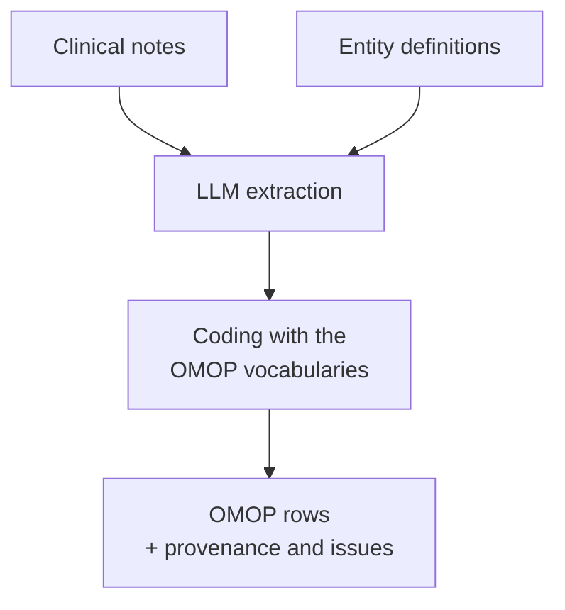

# Quick start: clinical notes to OMOP tables

This page takes you from a file of clinical notes to rows of
[OMOP CDM](https://ohdsi.github.io/CommonDataModel/cdm55.html) tables in four steps,
from the command line or from Python. Each step works on its own, so you can stop at
the one you need.



**Before you start:** install AATM ([Installation](installation.md)), set up the
vocabularies with `aatm init` ([Set up the vocabularies](setup.md)), and put your
provider's key in `.env`, e.g. `OPENAI_API_KEY=...`.

---

## 1. One note, one table

The predefined `ecog_performance_status` definition finds ECOG scores and fills the
`measurement` table. It needs no search index, only the vocabulary database and an LLM,
so it is the quickest way to see the whole pipeline work.

```python title="first_run.py"
import asyncio

from aatm.omop import ClinicalNote, OmopExtractionPipeline

pipeline = OmopExtractionPipeline("ecog_performance_status", model_id="openai/gpt-5-mini")

note = ClinicalNote(
    text="Assessment 05/12/2025\nOncology follow-up. Bedbound, ECOG 4.",
    note_id=107,
    person_id=3,
    note_date="2025-06-01",
)
tables = asyncio.run(pipeline([note]))
print(tables["measurement"].dropna(axis=1, how="all"))
```

| measurement_id | person_id | measurement_concept_id | measurement_date | measurement_type_concept_id | value_as_number | value_as_concept_id | measurement_source_value |
|---|---|---|---|---|---|---|---|
| 1 | 3 | 36305384 | 2025-05-12 | 32858 | 4.0 | 4174251 | ECOG 4 |

The model found "ECOG 4"; AATM coded it (*ECOG Performance Status score*, grade 4), took
the date from the note's text, and the patient from the `ClinicalNote`. In a notebook,
write `tables = await pipeline([note])` instead of `asyncio.run(...)`.

`tables` also tells you how every row was made:

```python
tables.to_dataframes(provenance=True)["measurement"]  # the exact words behind each row
tables.issues_dataframe()                             # what could not be filled, and why
tables.mappings_dataframe()                           # how each text was coded
```

---

## 2. A file of notes

Put your notes in a CSV or Parquet file with one row per note. Each note needs a unique
`note_id` and its `text`; `person_id`, `note_date`, `visit_occurrence_id`,
`visit_detail_id` and `provider_id` are used when present:

```csv title="notes.csv"
note_id,person_id,note_date,note_text
1,3,2025-06-01,"Oncology follow-up. Bedbound, ECOG 4."
2,8,2025-06-02,"Doing well, fully active. ECOG 0."
```

Then run the pipeline over the file. `--columns` (or `columns=`) renames a column to
the field it holds, here `note_text` to `text`:

=== "Command line"

    ```bash
    aatm omop run notes.csv output/ecog \
      --definitions ecog_performance_status \
      --model openai/gpt-5-mini \
      --columns note_text=text
    ```

=== "Python"

    ```python
    import asyncio

    from aatm.omop import OmopExtractionPipeline

    pipeline = OmopExtractionPipeline("ecog_performance_status", model_id="openai/gpt-5-mini")
    summary = asyncio.run(
        pipeline.run("notes.csv", "output/ecog", columns={"note_text": "text"})
    )
    print(summary)
    ```

The run reads the notes in chunks and writes each table as Parquet files under
`output/ecog/`. If it stops, run the same command again: notes already done are
skipped, and no model call is paid twice. Add `--limit 50` to try it on the first 50
notes.

---

## 3. Read the results

=== "Command line"

    ```bash
    aatm omop status output/ecog     # notes built and failed, rows per table, issues
    aatm omop failures output/ecog   # the notes that failed, and why
    ```

=== "Python"

    ```python
    from aatm.omop import OmopRun

    run = OmopRun("output/ecog")
    run.table("measurement")  # a pandas DataFrame
    run.provenance()          # note and text span of each row
    run.issues()
    run.status()              # {"built": 2, "failed": 0}
    ```

The folders are plain Parquet, so DuckDB, Polars or Spark read them directly, e.g.
`SELECT * FROM 'output/ecog/measurement/*.parquet'`, to load them into your CDM
database.

---

## 4. Conditions, drugs and other coded text

ECOG always codes to the same concept. A condition or a drug does not: the name in the
note must be searched in the vocabularies. That is the **coder**'s job, and it uses the
search index `aatm init` built. Add one, and as many definitions as you need, so each
note is sent to the model once:

=== "Command line"

    ```bash
    aatm omop run notes.csv output/clinical \
      --definitions condition_occurrence --definitions drug_exposure \
      --model openai/gpt-5-mini \
      --coder agent \
      --columns note_text=text \
      --cache
    ```

=== "Python"

    ```python
    import asyncio

    from aatm.omop import AgenticCoder, OmopExtractionPipeline

    pipeline = OmopExtractionPipeline(
        ["condition_occurrence", "drug_exposure"],
        model_id="openai/gpt-5-mini",
        coder=AgenticCoder("openai/gpt-5-mini"),  # searches the vocabularies with an agent
        cache=True,                               # code each distinct text once, across runs
    )
    summary = asyncio.run(
        pipeline.run("notes.csv", "output/clinical", columns={"note_text": "text"})
    )
    ```

`--coder mapper` (a `TerminologyMapper`) is cheaper, one search per distinct text;
`--coder agent` is more accurate on abbreviations and non-English text. Check the
choices in `run.mappings()`. See [Coding extracted text](coding_text.md) to choose.

The predefined definitions are:

| Definition | Table | Needs a coder |
|---|---|---|
| `ecog_performance_status` | `measurement` | no |
| `smoking_status` | `observation` | no |
| `lab_results` | `measurement` | yes |
| `family_history`, `medical_history` | `observation` | yes |
| `condition_occurrence` | `condition_occurrence` | yes |
| `drug_exposure` | `drug_exposure` | yes |
| `device_exposure` | `device_exposure` | yes |

---

## Where to go next

- **Something the predefined definitions do not cover?** Write your own in YAML:
  [From notes to OMOP tables](omop_tables.md#write-your-own-body-weight-step-by-step)
  and [Writing entity definitions](entity_definitions.md).
- **Thousands of notes?** Follow the [high-level guide](high_level.md): a pilot on a
  sample, a cost estimate, then the full run.
- **Need to change how a step works?** The [low-level guide](low_level.md) shows each
  building block on its own.
