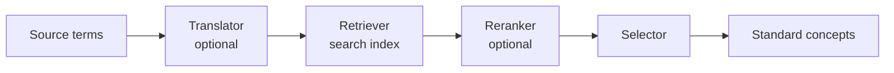

# Quick start: medical coding in Python

Medical coding, or terminology mapping, links a term (a local code's description, a
diagnosis written in a note, a lab test name in any language) to a standard OMOP
concept, and through it to every terminology the vocabularies connect. This page does
it with `TerminologyMapper`, from a list of texts or a CSV file, and then shows each
component of the mapper on its own. The same mapper, or the concept search agent, codes
the text extracted from notes into OMOP tables.

**Before you start:** run `aatm init` ([Set up the vocabularies](setup.md)). The mapper
searches the index it builds.



---

## 1. Map a few terms

```python
from aatm.terminology_mapper import TerminologyMapper

mapper = TerminologyMapper()   # the index aatm init built; the closest candidate wins
df = mapper.map(["chest pain", "type 2 diabetes mellitus"], save_to_disk=False)
df[["source_code_description", "target_concept_id", "target_vocabulary_id", "domain_id", "confidence_score"]]
```

Each row is one source term with the standard concept chosen for it: its id, vocabulary,
code and domain, and a `confidence_score`. Without `save_to_disk=False`, the result is
also written to `output/mapped_source_concepts.csv`.

## 2. Choose the components

The default selector takes the closest candidate, which is fast but often wrong for
short or ambiguous terms. Every component can be named by its registry id, or passed
as an object:

```python
mapper = TerminologyMapper(
    translator="gemini-2.5-flash",       # translate to English first (optional)
    retriever="text-embedding-3-small",  # which index to search (optional: the one aatm init built)
    reranker="bm25-reranker",            # reorder the candidates (optional)
    selector="gpt-5-mini",               # an LLM picks among the candidates
)
mapper.retriever.top_k = 30              # how many candidates the selector sees
df = mapper.map(["dor no peito", "diabetes mellitus tipo 2"], save_to_disk=False)
```

| Component | Registry ids |
|---|---|
| Translator | `empty-translator` (default), `gemini-2.5-flash` |
| Retriever | `text-embedding-3-small`, `text-embedding-3-large`, `gemini-embedding-001`, `embeddinggemma-300M`, `qwen3-06B`, `qwen3-4B` (only those you built) |
| Reranker | none (default), `bm25-reranker`, `qwen3-reranker-0.6b`, `qwen3-reranker-4b`, `qwen3-reranker-8b` |
| Selector | `first-result-selector` (default); LLMs: `gpt-5-mini`, `gpt-5`, `gpt-5.2`, `gpt-5-nano`, `gemini-2.5-flash`, `gemini-2.5-flash-lite`, `gemini-2.5-pro`, `gemini-3-flash-preview`, `gemini-3-pro-preview`; agent: `agent-gpt-5-mini`, `agent-gpt-5`, `agent-gpt-5.2`, `agent-gemini-2.5-flash`, `agent-gemini-3-flash-preview`; decision models: `decision-<decision model id>`, e.g. `decision-openrouter/typesafe/jev-1.13` |

LLM selectors only choose among the retrieved candidates. The **agent** searches
further when none fits: its own semantic searches, lexical search over names and
synonyms, code lookups, and the concept hierarchy:

```python
from aatm.concept_search import AgenticSelector

mapper = TerminologyMapper(selector=AgenticSelector("openai/gpt-5-mini", max_tool_calls=8))
df = mapper.map(["HbA1c", "creatinina sérica"], save_to_disk=False)
df[["source_code_description", "target_concept_id", "confidence_score", "mapping_rationale"]]
```

The agent adds a `mapping_rationale` (its reason) and a `mapping_trace` (its searches)
to each row, and its `confidence_score` is its confidence level: 0.9 (high), 0.6
(medium) or 0.3 (low). Any `aatm.llm` model id works, e.g.
`"anthropic/claude-sonnet-5-5"` or `"ollama/llama3.3"`. See
[Choosing between the mapper and the agent](coding_text.md#choosing-between-the-mapper-and-the-agent)
for a comparison on lab tests.

## 3. Restrict the search

`where` limits the candidates to a domain and vocabularies, written in ChromaDB's filter
syntax:

```python
from aatm.omop.coding import retriever_filter

df = mapper.map(
    ["potassium", "hemoglobin"],
    where=retriever_filter("Measurement", ["LOINC"]),
    save_to_disk=False,
)
```

See [Metadata filters](concepts.md#metadata-filters) for how filtering works on large
indexes.

## 4. Map a CSV file

The input follows the OMOP `SOURCE_TO_CONCEPT_MAP` layout, with these columns:
`source_code`, `source_concept_id`, `source_vocabulary_id`, `source_code_description`
(the text that is mapped), `valid_start_date`, `valid_end_date` and `invalid_reason`.

```csv title="source_to_concept_map.csv"
source_code,source_concept_id,source_vocabulary_id,source_code_description,valid_start_date,valid_end_date,invalid_reason
A01,,LOCAL,"Dor no peito",2020-01-01,2099-12-31,
B02,,LOCAL,"Diabetes mellitus tipo 2",2020-01-01,2099-12-31,
```

```python
mapper = TerminologyMapper(translator="gemini-2.5-flash", selector="gpt-5-mini", batch_size=100)
df = mapper.map(file_path="source_to_concept_map.csv", limit_to=20, output_dir="output")
```

`limit_to` maps only the first rows, for a test. The result is written to
`output/mapped_source_concepts.csv`; the original descriptions are kept in
`source_code_description_original` when a translator changed them.

If your columns have other names, rename them with `column_mapping` (the mapper does not
create missing columns):

```python
mapper = TerminologyMapper(
    selector="gpt-5-mini",
    column_mapping={
        "code": "source_code",
        "description": "source_code_description",
        "vocabulary": "source_vocabulary_id",
        "start_date": "valid_start_date",
        "end_date": "valid_end_date",
        "reason": "invalid_reason",
        "concept_id": "source_concept_id",
    },
)
df = mapper.map(file_path="my_input.csv")
```

!!! warning "Pass files as `file_path=`"
    The first argument of `map` is a list of terms. `mapper.map("file.csv")` maps the
    characters of the path; write `mapper.map(file_path="file.csv")`.

## 5. Save the configuration

The same settings as a reusable file, which `aatm map --task-config-path` also reads:

```yaml title="task.yaml"
input_file: source_to_concept_map.csv
output_dir: output
translator_id: gemini-2.5-flash
selector_id: gpt-5-mini
batch_size: 100
```

```python
from aatm.data_models import TerminologyMappingTask
from aatm.terminology_mapper import TerminologyMapper

task = TerminologyMappingTask.from_config_file("task.yaml")
df = TerminologyMapper.from_task_config(task).map()
```

## 6. Asynchronous mapping

In an async application (or a notebook), `amap` maps a file without blocking the event
loop, and writes `mapped_source_concepts.csv` like `map`:

```python
df = await mapper.amap("source_to_concept_map.csv", limit_to=20)
```

---

## The components on their own

Each component is callable, so you can inspect what each step produces, and they
compose with `|`:

```python
from aatm.registries.rerankers import load_reranker
from aatm.registries.retrievers import load_retriever
from aatm.registries.selectors import load_selector
from aatm.registries.translators import load_translator

translator = load_translator("empty-translator")
retriever = load_retriever()             # the index aatm init built
reranker = load_reranker("bm25-reranker")
selector = load_selector("gpt-5-mini")

translations = translator(["chest pain", "cough"])   # list[Translation]
candidates = retriever(translations)                  # RetrieverResults: candidates per query
reranked = reranker(candidates)                       # RetrieverResults, reordered
selected = selector(reranked)                         # SelectorResults: one choice per query

selected = ["chest pain", "cough"] | translator | retriever | reranker | selector
```

`candidates.results[0]` lists the concepts retrieved for the first term, with their
`std_concept_id`, `std_concept_name`, `std_vocabulary_id`, `std_domain_id` and
`distance`. To write a selector or another component of your own, see the
[low-level guide](low_level.md#terminology-mapping-piece-by-piece).

A configured `TerminologyMapper` can also code the text extracted from clinical notes
into OMOP tables: pass it as `coder=` (see [Coding extracted text](coding_text.md)).

---

## Troubleshooting

| You see | Fix |
|---|---|
| `No vector database for '<model>'` | That index is not built: use a model `aatm vector-db check` lists, leave `retriever` out, or build it with `aatm init --embedding-model <model>` |
| `Several vector databases are built and none is recorded` | Pass `retriever="<model>"`, or run `aatm init --embedding-model <model>` and choose Skip to record it |
| The CSV fails validation | Check the required columns above, or pass `column_mapping` |
| The results are one row per character of your file name | Pass the file as `file_path=` |
| An LLM component fails with an authentication error | Check the provider's key in `.env` ([Environment variables](env.md)) |
| A component name is rejected | Use a registry id from the table above; `load_*` raises `ValueError` for unknown names |
