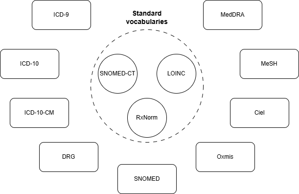

---
hide:
  - navigation
  - toc
---

# Any-to-Any Terminology Mapping

**Turn clinical text into coded, standard data.** AATM is an open-source Python library
that reads clinical documents with LLMs, codes what it finds with the
[OMOP standard vocabularies](https://athena.ohdsi.org/search-terms/start) (SNOMED CT,
LOINC, RxNorm, UCUM and the terminologies mapped to them), and writes
[OMOP CDM](https://ohdsi.github.io/CommonDataModel/cdm55.html) tables you can load and
analyse, with every value traceable to the words it came from.

It does three jobs. Use any one of them alone, or chain them:

<div class="grid cards" markdown>

-   :material-text-search:{ .lg .middle } **Clinical information extraction**

    ---

    Find conditions, drugs, devices, lab results, scores, dates and their details in
    free-text notes, with the LLM of your choice. You describe what to find in plain
    words in a YAML file; AATM checks every mention against the note, so only text
    that is really there survives, with its exact position.

    [:octicons-arrow-right-24: Information extraction](getting-started/quick_start_extraction.md)

-   :material-tag-text:{ .lg .middle } **Medical coding**

    ---

    Code any clinical expression, in any language, abbreviated or not, to a standard
    concept: by semantic search over every concept name and synonym, then the closest
    match, an LLM, a decision model, or an **agent** that searches the vocabularies
    with tools and reads the note's context. Every code is checked to be standard,
    valid and of the right domain.

    [:octicons-arrow-right-24: Medical coding](getting-started/quick_start_python_api.md)

-   :material-table-large:{ .lg .middle } **Notes to OMOP CDM tables**

    ---

    Both, end to end: rows of `condition_occurrence`, `drug_exposure`,
    `device_exposure`, `measurement` and `observation`, built as the CDM and THEMIS
    conventions ask, with provenance and a reason for every gap. From one note to
    millions: resumable runs, batch pricing, sharding, cost estimates, a command line.

    [:octicons-arrow-right-24: Notes to OMOP tables](getting-started/quick_start_omop.md)

</div>

---

## Clinical information extraction

Clinical notes hold most of what happens to a patient, but in sentences, not
columns. AATM extracts it with one structured LLM call per note, guided by **entity
definitions**: a YAML file that says, in words the model reads, what each entity is,
what it contains, and how to classify it.

```python
from aatm.data_models.extractors import EntityDefinitions
from aatm.extractors import SimpleLLMExtractor

extractor = SimpleLLMExtractor(
    model_id="openai/gpt-5-mini",  # or gemini/..., anthropic/..., ollama/..., any OpenAI-compatible server
    entity_definitions=EntityDefinitions.from_predefined("drug_exposure"),
)
results = await extractor(["Home meds: metformin 500 mg PO BID since 2020. Allergic to penicillin."])

for drug in results[0].to_records():
    print(drug.text, drug.attributes, {k: [c.text for c in v] for k, v in drug.children.items()})
# e.g. metformin 500 mg {'kind': 'taking', 'route': 'oral'} {'verbatim_start_date': ['2020'], 'sig': ['500 mg PO BID']}
```

- **Grounded, never paraphrased.** The note is sent as numbered lines; each mention
  comes back with its line, and is kept only if its exact text is on that line. Every
  entity has character offsets into the note; every rejected candidate is kept with the
  reason (`text_not_in_line`, `invalid_parent`...).
- **Structure, not just spans.** Entities nest: a drug has a dose, a route and dates; a
  lab test has a value and a unit; links point to ids, so "2019" belongs to the right
  condition. **Attributes** classify each mention from a fixed list of labels (a
  condition's status, a drug's kind, an ECOG grade), checked against the definition.
- **Your definitions, or ours.** Eight are predefined (conditions, drugs, devices, lab
  results, ECOG performance status, smoking, family and medical history), following the
  CDM conventions on what to leave out: negated, ruled-out and family conditions,
  considered-only drugs, allergies. Your own are a YAML file, with completion and inline
  errors in your editor.
- **Any LLM.** OpenAI, Gemini, Anthropic, OpenRouter, Ollama, vLLM or any
  OpenAI-compatible server, or your own client. Rate limits and retries are shared by
  every call, and **decision models** can label attributes with probabilities.

[Information extraction quick start](getting-started/quick_start_extraction.md) ·
[Writing entity definitions](getting-started/entity_definitions.md)

## Medical coding

A term is only useful for analysis once it is linked to a standard concept. The OMOP
vocabularies link the world's terminologies and classifications (ICD-10, CPT, MedDRA,
national drug codes and many more) through **standard concepts**: once a text is linked
to one, every terminology connected to it is one step away.


/// caption
Standard concepts connect the world's terminologies
///

AATM codes a text in three steps: an optional **translation**, a **retrieval** of
candidates from a search index of every standard concept's names and synonyms (about
2.5 million expressions), and a **selection**:

| Selector | Picks | Best for |
|---|---|---|
| Closest match | The nearest candidate | Explicit, English terms; free and instant |
| LLM selector | The best of the top candidates | Most terms; one LLM call each |
| Decision model | The best candidate, with a probability | When you need a confidence to filter on |
| **Concept search agent** | Whatever its tools find: semantic and lexical search, code lookups, concept details, the hierarchy | Abbreviations, other languages, variants that differ by specimen or unit |

```python
from aatm.concept_search import AgenticSelector
from aatm.terminology_mapper import TerminologyMapper

mapper = TerminologyMapper(selector=AgenticSelector("openai/gpt-5-mini"))
mapper.map(["HbA1c", "creatinina sérica", "dor torácica"], save_to_disk=False)
```

- **Accurate where it is hard.** On 30 lab tests with gold LOINC codes (abbreviations,
  Portuguese names, urine and 24-hour tests), the agent with the note's context coded 29
  correctly, an LLM selector over the top 30 candidates 14, and the closest match 1.
- **Checked, not trusted.** Every concept is verified against the vocabulary database:
  a non-standard or wrong-domain answer is never stored silently. Searches can be
  restricted to a domain and vocabularies.
- **Batch or interactive.** Code a `SOURCE_TO_CONCEPT_MAP` CSV with `aatm map`, a list
  of terms in Python, a REST API with `aatm serve`, or explore in `aatm search-ui`.
- **Your index, where you want it.** Six embedding models (OpenAI, Gemini, or local
  models on your GPU), in a local ChromaDB, Chroma Cloud or Pinecone.

[Medical coding in Python](getting-started/quick_start_python_api.md) ·
[from the command line](getting-started/quick_start_cli.md) ·
[Coding extracted text](getting-started/coding_text.md)

## Notes to OMOP CDM tables

Extraction and coding together, with the CDM's rules on top. Where each value goes is
in the entity definition's `omop` block (never sent to the model); AATM extracts, codes,
reads dates, infers what the conventions allow (a drug's end date from its duration, a
device's quantity), and reports what it could not fill.

=== "Command line"

    ```bash
    aatm omop run notes.parquet output/ \
      --definitions condition_occurrence --definitions drug_exposure \
      --model openai/gpt-5-mini --coder agent --cache
    aatm omop status output/
    ```

=== "Python"

    ```python
    from aatm.omop import AgenticCoder, OmopExtractionPipeline, OmopRun

    pipeline = OmopExtractionPipeline(
        ["condition_occurrence", "drug_exposure"],
        model_id="openai/gpt-5-mini",
        coder=AgenticCoder("openai/gpt-5-mini"),
        cache=True,
    )
    await pipeline.run("notes.parquet", "output/")
    OmopRun("output/").table("drug_exposure")
    ```

- **Traceable.** Each row keeps the note and the span of text it came from; each gap
  is an issue with a reason (`unmapped`, `low_confidence`, `imputed_date_parts`...).
- **Built for real datasets.** Notes stream in chunks from files or SQL; Parquet comes
  out; a ledger makes every run resumable and every model call paid once. Rebuild the
  tables after a mapping change without extracting again.
- **Cost under control.** A dry run estimates calls, tokens, cost and time from a
  pilot; provider batch APIs halve the price; a coding cache codes each distinct text
  once; shards spread a run across machines.
- **Iterate on evidence.** A pilot workspace versions your attempts on a fixed sample
  and shows what changed between them: rows, issues, mentions, codes, cost.

[Quick start](getting-started/quick_start_omop.md) ·
[High-level guide: a full dataset](getting-started/high_level.md)

---

## Use it at the level you need

| Level | You write | Guide |
|---|---|---|
| **Command line** | Flags, or a YAML file of options: `aatm init`, `aatm omop run`, `aatm map` | [Command line reference](reference/cli.md) |
| **Pipelines** | A few lines of Python: `OmopExtractionPipeline`, `Pilot`, `TerminologyMapper` | [High-level guide](getting-started/high_level.md) |
| **Building blocks** | Your own LLM client, coder, selector or vocabulary source, plugged into the pipelines | [Low-level guide](getting-started/low_level.md) |

## Design principles

**Grounded.** Nothing an LLM returns is trusted as is: spans are matched to the note,
codes to the vocabularies, and every gap is reported rather than filled with a guess.

**Standard first.** Every code is a standard OMOP concept, so results are comparable
across sites and connected to every terminology the vocabularies link.

**Modular.** Extraction, translation, retrieval, reranking, selection, coding and table
building are separate components with small interfaces, each replaceable on its own.

**Simple to start, open to tune.** One command runs the whole pipeline; every default
can be overridden when your data needs it.

## Get started

1. [Install](getting-started/installation.md): `pip install aatm`.
2. [Set up the vocabularies](getting-started/setup.md): `aatm init`, once per project.
3. Pick a quick start: [information extraction](getting-started/quick_start_extraction.md),
   [medical coding](getting-started/quick_start_python_api.md) or
   [notes to OMOP tables](getting-started/quick_start_omop.md).

New in 0.4.0: see the [release notes](release_notes.md).
